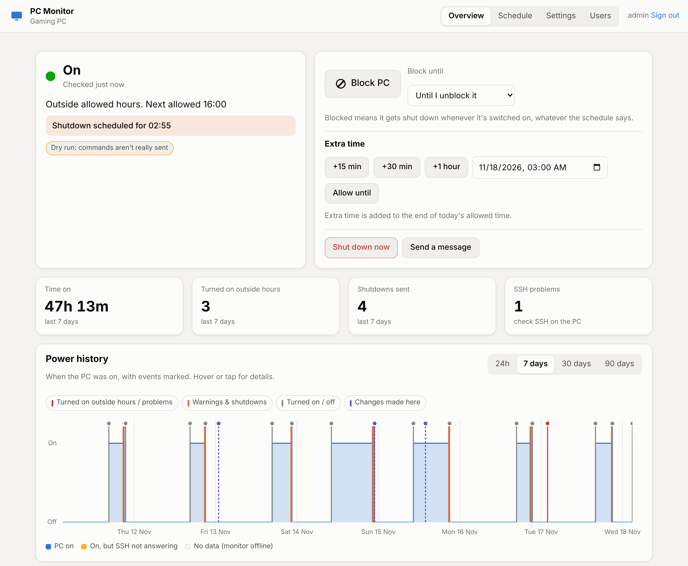
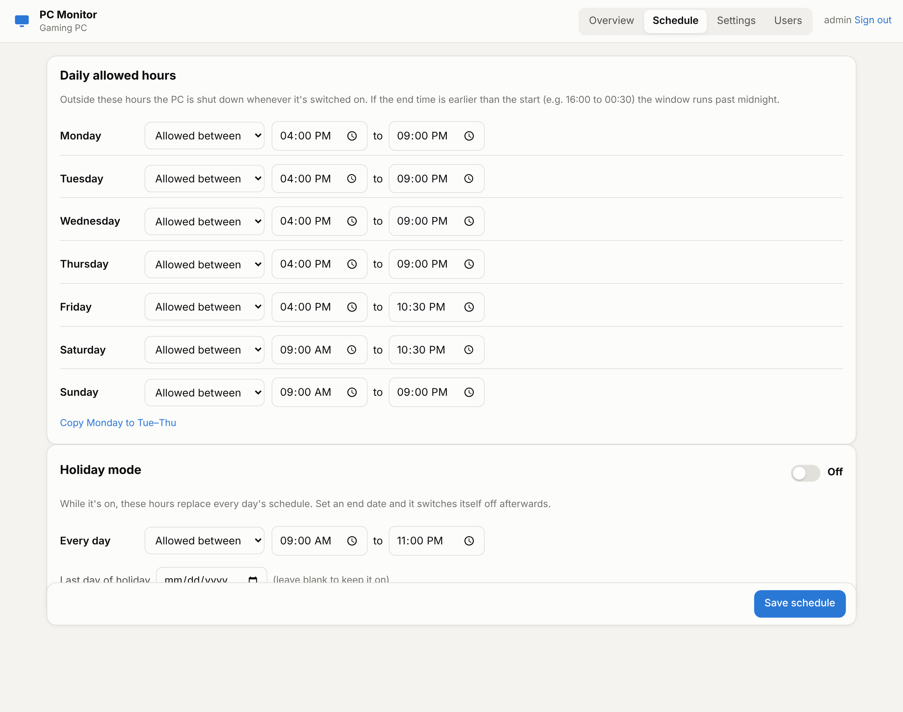
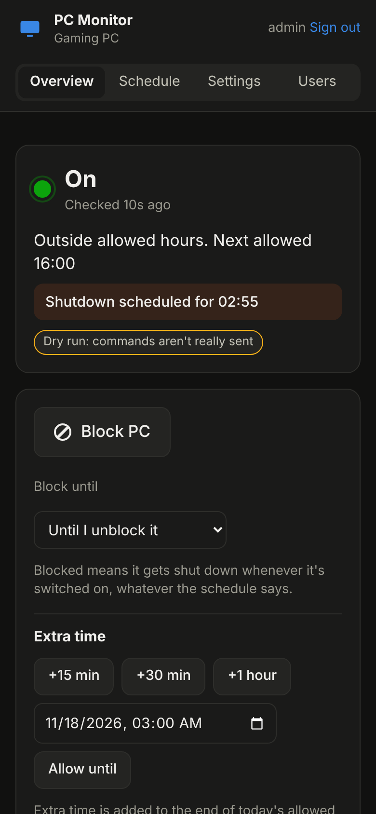

# PC Monitor

A small self-hosted website that watches a Windows PC, keeps a history of when it was on, and shuts it down outside the allowed hours.

## Why I built this

I wanted a reliable way to manage a Windows PC's permitted usage hours remotely, without manually checking whether it was running or repeatedly intervening to shut it down.

What started as a scheduling requirement grew into a self-hosted monitoring and automation application with configurable rules, remote actions, notifications and an audit history.

I used Claude to help turn my requirements into a working application, testing the results and refining the behaviour through multiple iterations.

## Screenshots

The overview: current status, quick controls, and a power-history graph with events marked on it.



Per-day allowed hours, with a holiday mode that overrides them.





These were taken in demo mode with made-up history (see [Preview with fake data](#files-and-data)).

## Features


- **Per-day allowed hours.** Each day can have a time window (it can run past midnight), be allowed all day, or not be allowed at all.
- **Holiday mode.** One set of hours replaces every day until an end date you choose, then switches itself off.
- **Block button.** While blocked, the PC is shut down whenever it's switched on. A block can last until you lift it, for an hour, until 07:00 tomorrow, or until a time you pick.
- **Extra time.** Add 15 or 30 minutes, an hour, or allow it until a set time.
- **Staged warnings.** By default it warns 15, 5 and 1 minute before the cut-off. Each warning also schedules the shutdown *on the PC itself*, so it still happens if this server goes offline.
- **Switched back on outside hours.** The first time, it gets a short countdown (60 seconds by default). After that it's shut down immediately, and you're notified.
- **Tamper alert.** If the PC is on the network but SSH stops answering (the service was stopped, the firewall blocks it, and so on), you get an alert.
- **History.** A power-history graph with events marked on it (hover or tap for details), daily totals, and an event log showing who changed what.
- **Separate logins** for each person, with admins who can add and remove people.
- **Phone alerts** through [ntfy](https://ntfy.sh), which has free iOS and Android apps.

## How I used AI

I used Claude extensively throughout development to generate and refine the application's Python backend, web interface and automation logic.

My contribution was defining the requirements, specifying the intended behaviour, testing the application, identifying issues and directing improvements through iterative prompts.

AI made it possible for me to create a much more complete application than I could have built independently at the time. The project also reinforced the importance of validating AI-generated code, particularly when it controls real devices and performs automated actions.

---

## 1. Prepare the Windows PC

The PC needs Windows' built-in **OpenSSH Server** installed and running (Settings → System → Optional features → OpenSSH Server).

**a) Fixed IP.** In your router, add a DHCP reservation so the PC always gets the same IP address.

**b) Make sure SSH starts with Windows.** In an admin PowerShell:

```powershell
Set-Service sshd -StartupType Automatic
Start-Service sshd
```

**c) Set up an SSH key for the server.** Do this on the Docker machine, inside the project folder:

```bash
mkdir -p data/ssh
ssh-keygen -t ed25519 -f data/ssh/id_ed25519 -N "" -C pc-monitor
cat data/ssh/id_ed25519.pub
```

Copy the line it prints. On the PC, open **PowerShell as administrator**. If the SSH account is an administrator (it needs to be, to run `shutdown`), Windows only reads keys from this one file:

```powershell
Add-Content -Force -Path "$env:ProgramData\ssh\administrators_authorized_keys" -Value 'ssh-ed25519 AAAA...paste... pc-monitor'
icacls.exe "$env:ProgramData\ssh\administrators_authorized_keys" /inheritance:r /grant "Administrators:F" /grant "SYSTEM:F"
```

**d) Test it** from the Docker machine:

```bash
ssh -i data/ssh/id_ed25519 youradminuser@192.168.1.50 whoami
```

If you'd rather use a password, set `PC_SSH_PASSWORD` in `.env` instead. A key is safer.

**e) Save the PC's host key.** The server only talks to the PC if its SSH host key matches one you've saved, so another device that takes over the PC's IP address can't pretend to be it. On the Docker machine:

```bash
ssh-keyscan -t ed25519 192.168.1.50 > data/known_hosts
ssh-keygen -lf data/known_hosts
```

Then on the PC, in PowerShell:

```powershell
ssh-keygen -lf C:\ProgramData\ssh\ssh_host_ed25519_key.pub
```

The two `SHA256:...` fingerprints must be identical. If they aren't, delete `data/known_hosts` and find out what's answering at that IP before going further. If SSH uses a port other than 22, add `-p <port>` to `ssh-keyscan`.

If Windows is ever reinstalled, the PC gets a new host key. The site will then show a "host key has CHANGED" error until you repeat this step. (If you'd rather skip this step, `SSH_TRUST_FIRST_USE=true` accepts whatever key answers first. It's easier, but less safe.)

## 2. Run it on the Docker machine

```bash
cp .env.example .env
nano .env                    # PC_HOST, PC_SSH_USER, ADMIN_USERNAME/ADMIN_PASSWORD
docker compose up -d --build
docker compose logs -f       # watch it start
```

Open `http://<docker-machine-ip>:8080` and sign in with the admin details from `.env`. If you left `ADMIN_PASSWORD` blank, the first visit asks you to create the admin account. Then:

1. **Users tab:** add an account for each parent (tick *Admin* if they should be able to manage accounts).
2. **Schedule tab:** set each day's hours.
3. **Settings tab:** set the warning times, then add notifications (below).

**Test it on the real PC before relying on it.** The automated tests use a simulated PC, so these checks are the first time real SSH and Windows are involved:

1. Start with `DRY_RUN=true`. The site monitors and logs what it *would* send, without sending it. Leave it for an evening and check the graph and log match what really happened.
2. Set `DRY_RUN=false` and turn **Enforcement** off in Settings. The status card should say SSH is working, and Settings → Connection should show the host key as "saved".
3. While you're in the room, press **Shut down now**. It should show a 60-second notice, then shut down.
4. Turn Enforcement on. Give extra time, wait for a warning, and check the notice appears on the PC. Then press **Block** and check it shuts down within about a minute.
5. Stop the server, restart the PC, then start the server again. The log should say the PC was restarted and the warnings were scheduled again.

The compose file uses `network_mode: host` so the ARP check can see the PC on your network. If port 8080 is already used on that machine, change `PORT` in `.env`.

## 3. Phone notifications (ntfy)

1. Install **ntfy** from the App Store or Play Store.
2. Subscribe to a topic with a long random name, e.g. `pcmonitor-k3j9x2q7v8`. Anyone who knows the name can read the alerts on the public server, so keep it unguessable.
3. In **Settings → Phone notifications**, paste `https://ntfy.sh/pcmonitor-k3j9x2q7v8`, choose which events notify you, and press **Send test notification**.
4. The parents subscribe to the same topic on their phones.

You can also run your own ntfy server in Docker and add an access token.

## 4. Using it away from home

**Don't port-forward this to the internet.** Whatever runs this site holds a key that can shut down a PC on your network. To use it from outside the house, connect to your home network over a VPN first (WireGuard, Tailscale, or UniFi Teleport once you have the UDM). If you put it behind an HTTPS reverse proxy, set `COOKIE_SECURE=true`.

---

## How the enforcement works

The server checks the PC every 30 seconds (`POLL_SECONDS`).

| Situation | What happens |
|---|---|
| Allowed, 15/5/1 min before the end | Warning appears on the PC, and Windows' own shutdown timer is set for the cut-off |
| Cut-off reached | Windows shuts down on its timer. If it's still on 45 seconds later (e.g. someone ran `shutdown /a`), it's shut down immediately |
| Switched on outside allowed hours, or while blocked | First time: 60-second countdown (configurable). Still on, or back on: immediate shutdown. A "Turned on outside allowed time" alert is sent |
| Extra time given or unblocked while a shutdown is pending | The pending shutdown is cancelled |
| On the network but SSH not answering for about 2 minutes | "On, but SSH not responding" alert, and an amber band on the graph |
| SSH answers but logging in fails (key removed, account changed) | Same alert, saying the login failed. A real login is tested every 5 minutes (`AUTH_CHECK_SECONDS`) and whenever the PC comes on |
| A shutdown command fails | Retried at the next check (30 seconds), with one alert per run of failures rather than one every time |
| Blocked while the normal end-of-day timer is already counting down | The block takes over straight away with its own 60-second countdown, rather than waiting for the old timer |
| PC restarted while the server was offline | Spotted from Windows' boot time when the server reconnects. The old timer record is dropped and warnings are scheduled again |
| Enforcement paused while a shutdown is scheduled | The scheduled shutdown is cancelled. If SSH is down at that moment, the site warns you and keeps trying until it works. A manual **Shut down now** isn't cancelled |

**If someone cancels a shutdown on the PC** (`shutdown /a`): Windows can't be asked whether a shutdown is scheduled without cancelling it, so the site can't see the cancel. Instead, it waits a short safety window and then shuts down again if the PC is still on. That's 45 seconds after the cut-off, or about 2½ minutes after a block or out-of-hours countdown. A manual **Shut down now** isn't replaced by automatic enforcement while it's counting down.

Scheduled shutdowns and warnings already sent are saved in the database, so restarting the container doesn't lose track of them. All times on the site are shown in the server's `TZ`, whatever time zone your phone is set to.

Warnings use `shutdown /s /t <seconds> /c "<message>"`, which shows a Windows notification on both Home and Pro. **Send a message** uses `msg *`, which only exists on Pro and Education editions.

## Limits: if the PC's user is an administrator

With an administrator account, the person using the PC can stop the SSH service, block it in the firewall, delete the key, or change the PC's IP. Most of this gets **detected**: the ARP check still sees the PC on the network, so you get the tamper alert. They can still **get round** it, though. Changing the PC's IP or MAC address, or using a different network, would make it look "off".

The real fix is to make their everyday Windows account a **standard user**. Keep a separate admin account (the one SSH logs in to) that they don't have the password for. They can then no longer change SSH, the firewall or the key.

Sleep and hibernate show as "off" on the graph, because a sleeping PC doesn't answer.

---

## Files and data

```
app/            Python backend (FastAPI) and the web UI in app/static/
data/           Created on first run: pcmonitor.db (history, settings, accounts), ssh key, secret key
tests/          Schedule and enforcement tests: uv run pytest (each test gets its own empty database). Date tests: tests/run_tz_tests.sh (needs Node)
scripts/        seed_demo.py fills a throwaway database with two weeks of made-up history
```

To back up, copy the `data/` folder.

To update, replace the files and run `docker compose up -d --build`.

**Preview with fake data (no PC needed):**

Linux / macOS:

```bash
DATA_DIR=./demo-data uv run python -m scripts.seed_demo
DATA_DIR=./demo-data DRY_RUN=true CHECK_ARP=false PC_HOST=127.0.0.1 PC_SSH_USER=x \
  ADMIN_PASSWORD=demo12345 uv run uvicorn app.main:app --port 8080
```

Windows (Command Prompt):

```bat
set DATA_DIR=demo-data
set DRY_RUN=true
set CHECK_ARP=false
set PC_HOST=127.0.0.1
set PC_SSH_USER=x
set ADMIN_PASSWORD=demo12345
uv run python -m scripts.seed_demo
uv run uvicorn app.main:app --port 8080
```

Windows (PowerShell):

```powershell
$env:DATA_DIR="demo-data"; $env:DRY_RUN="true"; $env:CHECK_ARP="false"
$env:PC_HOST="127.0.0.1"; $env:PC_SSH_USER="x"; $env:ADMIN_PASSWORD="demo12345"
uv run python -m scripts.seed_demo
uv run uvicorn app.main:app --port 8080
```

Then open http://localhost:8080 and sign in as `admin` / `demo12345`. These variables only last for that terminal window. Run the seed step once only, because running it again adds a second copy of the fake history.

Dependencies are managed with [uv](https://docs.astral.sh/uv/): they're listed in `pyproject.toml` and pinned in `uv.lock`. To upgrade them, run `uv lock --upgrade`, then `uv run pytest`, then rebuild the container.
